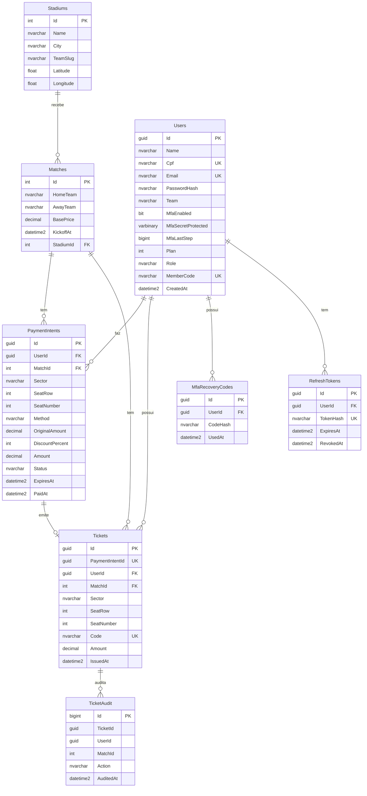

# Projeto do banco de dados: Champions Card / TicketFut

Banco: **SQL Server** (imagem `mssql/server:2022` no Docker). Nome do banco: `TicketFut`.
Este documento é a base para a Etapa 7 do manual do PIM IV: modelo lógico, modelo físico, MER, procedures, triggers e script completo.

## 1. MER (modelo entidade-relacionamento)

O diagrama abaixo usa a sintaxe Mermaid. O GitHub e o VS Code (extensão Markdown Preview Mermaid) o desenham sozinhos. Para colocar no relatório como figura, cole o bloco em <https://mermaid.live> e exporte em PNG.

## 2. Modelo lógico

Entidades, atributos e relacionamentos, sem detalhes de SQL Server.

| Entidade | Atributos principais | Relacionamentos |
|---|---|---|
| Estádio | nome, cidade, time, latitude, longitude | 1 estádio recebe N partidas |
| Partida | time da casa, visitante, preço base, data e hora | pertence a 1 estádio; tem N pagamentos e N ingressos |
| Usuário | nome, CPF, e-mail, senha (hash), time, plano de sócio, papel, código de sócio, dados do autenticador (MFA) | faz N pagamentos; possui N ingressos; tem N códigos de recuperação do MFA; tem N tokens |
| Pagamento (intenção) | setor, fileira, cadeira, forma, valor original, desconto, valor final, status, validade | de 1 usuário, para 1 partida; emite 0 ou 1 ingresso |
| Ingresso | código, setor, fileira, cadeira, valor, data de emissão | de 1 usuário, para 1 partida; vem de 1 pagamento |
| Código de recuperação do MFA | hash do código, data de uso, data de criação | de 1 usuário |
| Token de renovação | hash, validade, data de revogação | de 1 usuário |
| Auditoria de ingresso | ingresso, ação, data | registra cada ingresso emitido |

Regras de negócio que o modelo garante:

1. Cada cadeira de uma partida tem no máximo um ingresso e no máximo um pagamento ativo.
2. O CPF, o e-mail, o código de ingresso e o código de sócio não se repetem.
3. Ingresso emitido não é apagado nem alterado.
4. O status do pagamento só pode ser `Pending`, `Paid`, `Failed` ou `Expired`.
5. O papel do usuário é `User` ou `Admin`; o plano é 0, 5, 10 ou 20 (percentual de desconto).

## 3. Modelo físico

O dicionário completo (tipos, tamanhos, chaves e índices) está no script `01-esquema.sql`. Resumo:

| Tabela | Chave primária | Chaves estrangeiras | Índices únicos |
|---|---|---|---|
| Stadiums | Id (int, identity) | n/a | n/a |
| Matches | Id (int, identity) | StadiumId → Stadiums | n/a |
| Users | Id (uniqueidentifier) | n/a | Cpf, Email, MemberCode (filtrado: não nulo) |
| MfaRecoveryCodes | Id | UserId → Users (cascata) | n/a (índice comum em UserId) |
| PaymentIntents | Id | MatchId → Matches; UserId → Users | (MatchId, Sector, SeatRow, SeatNumber) filtrado: assento informado e status diferente de Failed e Expired |
| RefreshTokens | Id | UserId → Users (cascata) | TokenHash |
| Tickets | Id | MatchId → Matches; UserId → Users | Code; PaymentIntentId; (MatchId, Sector, SeatRow, SeatNumber) filtrado: assento informado |
| TicketAudit | Id (bigint, identity) | n/a | n/a |

Observação: `Tickets.PaymentIntentId` não tem chave estrangeira. A API grava o pagamento e o ingresso na mesma transação e o Entity Framework não garante a ordem entre os dois. A unicidade fica garantida pelo índice único.

## 4. Restrições CHECK (arquivo `03`)

Papel do usuário, plano, CPF com 11 dígitos, times diferentes na partida, preço base maior que zero, setor, forma de pagamento, status, valores (final não maior que o original, desconto de 0 a 100) e assento (fileira e cadeira juntas, maiores que zero).

## 5. Views

| View | Para quê |
|---|---|
| `vw_IngressosDetalhados` | ingresso com partida, estádio e torcedor. Não expõe CPF nem hash de senha |
| `vw_VendasPorPartida` | ingressos, receita e ticket médio por partida |

## 6. Procedures

| Procedure | O que faz |
|---|---|
| `sp_VendasPorPartida @MatchId` | relatório de vendas (todas as partidas ou uma) |
| `sp_IngressosDoUsuario @UserId` | ingressos de um torcedor |
| `sp_AssentosOcupados @MatchId, @Sector` | cadeiras vendidas e reservadas |
| `sp_ExpirarIntencoesPendentes` | libera cadeiras de pagamentos pendentes vencidos |
| `sp_ResumoAdmin` | totais, receita por setor e por plano de sócio |

## 7. Triggers

Só existem triggers na tabela `Tickets`. Na `PaymentIntents` não pode haver trigger: a API atualiza essa tabela com a cláusula `OUTPUT` e o SQL Server recusa isso quando a tabela tem trigger.

| Trigger | Tabela | Regra |
|---|---|---|
| `TR_Tickets_Auditoria` | Tickets (após inserir) | grava linha em `TicketAudit` |
| `TR_Tickets_NaoApagar` | Tickets (após apagar) | bloqueia a exclusão |
| `TR_Tickets_Imutavel` | Tickets (após alterar) | bloqueia mudança de dono, jogo, assento, código e valor |

## 8. Arquivos e ordem de execução

| Arquivo | Uso |
|---|---|
| `00-script-completo.sql` | **banco novo**: cria o banco e tudo (é o `01` + o `03`) |
| `01-esquema.sql` | só as tabelas, chaves e índices |
| `03-regras-procedures-triggers.sql` | regras, views, procedures e triggers (pode rodar de novo) |
| `02-verificar.sql` | confere se o banco tem o que a API usa |
| `05-testes-demonstracao.sql` | prova cada regra e apaga os dados de teste |

Rodar dentro do Docker (a senha vem da variável do próprio container, sem aparecer no comando):

    docker exec -i pim-backend-db-1 bash -c '/opt/mssql-tools18/bin/sqlcmd -C -S localhost -U sa -P "$MSSQL_SA_PASSWORD" -d TicketFut -I -W' < 05-testes-demonstracao.sql
